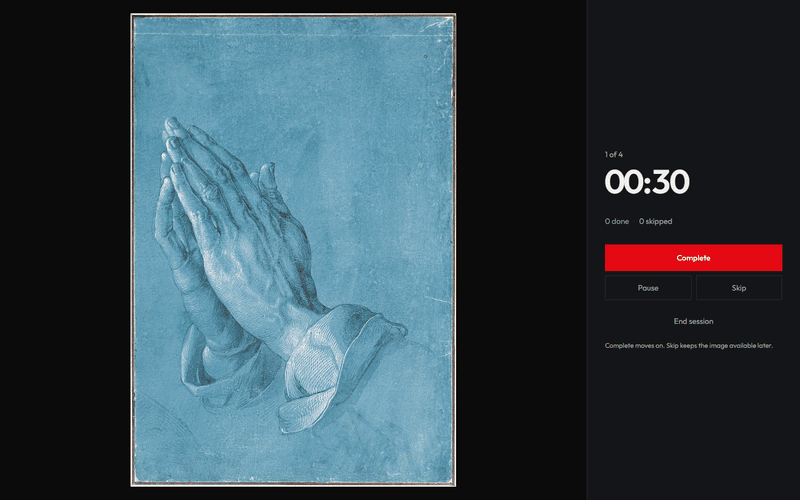
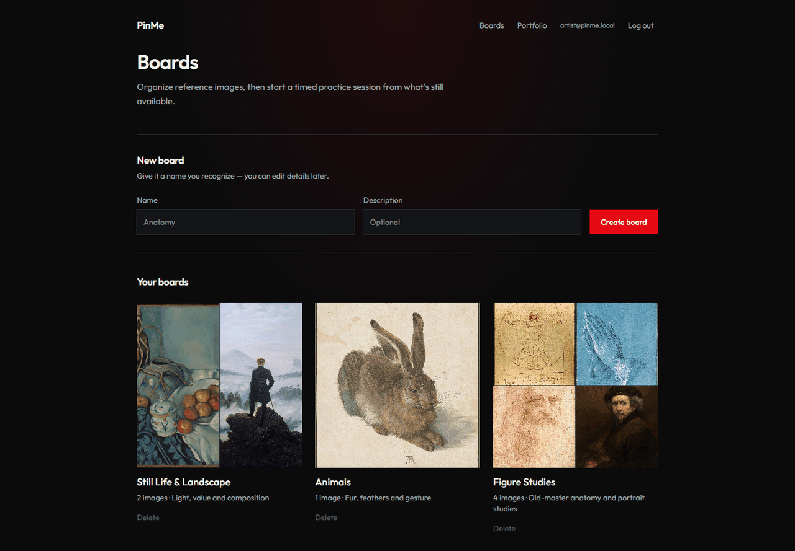
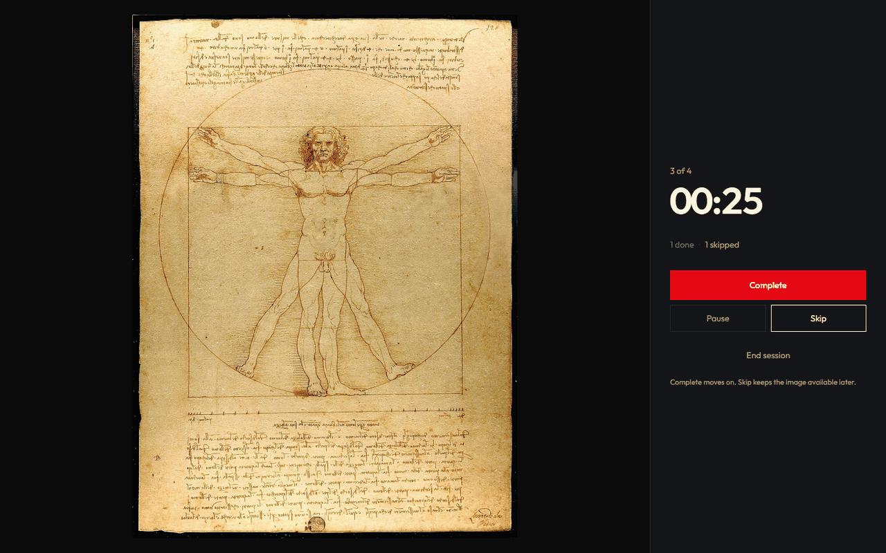
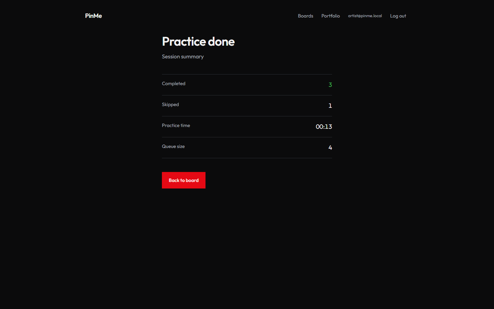
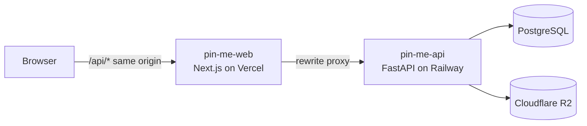

# PinMe Web

[](https://github.com/gmorlo/pin-me-web/actions/workflows/ci.yml)
[](LICENSE)


Frontend for **PinMe**, a drawing-practice app: artists keep reference boards and run timed, non-repeating practice sessions from their own images.

**Portfolio:** [francke.tech](https://francke.tech) · **Backend repo:** [pin-me-api](https://github.com/gmorlo/pin-me-api)

> **Live demo is currently offline.** The API host trial ended, so the app runs locally for now. The screenshots below show it running.



| Boards | Practice | Summary |
|---|---|---|
|  |  |  |

<sub>Reference images in the screenshots are public-domain artworks from Wikimedia Commons.</sub>

## Problem

Artists save references in messy folders and boards, then keep redrawing the same favourites. PinMe turns a board into a practice queue: each image is drawn once, and the board only refills when you decide to reset it.

## What you can do

- **Boards:** create and edit boards, upload references (JPEG/PNG/WebP), browse them in a grid with a random cover preview.
- **Start a session:** choose time per image and how many images to draw.
- **Practice screen:** large reference, countdown timer, progress (`3 / 10`), Pause, Skip and Complete. It stays minimal on purpose so the image gets the attention.
- **Summary:** completed, skipped and total practice time, with an option to reset the board's progress.
- **Sign in with Google** (allowlisted accounts). Boards and practice routes are protected.

## How it works

Production setup used until November 2026 (Vercel + Railway + Neon + R2). The API is not hosted at the moment.



## Engineering decisions

1. **Same-origin API proxy.** The browser only talks to `/api/*` on the web origin, and `next.config.ts` rewrites it to the API. `vercel.app` and `railway.app` are different sites, so this keeps the auth cookie first-party instead of being blocked as a third-party cookie. The build fails on Vercel if `API_ORIGIN` is missing, so a misconfigured deploy cannot ship.
2. **Server state and timer state are separate.** TanStack Query owns everything that comes from the API (boards, images, session queue). After each Complete or Skip it stores the updated session the API returns, so the screen never shows a guessed state. A small Zustand store owns only the countdown, which is reset when the current image changes.
3. **The backend decides what comes next.** The UI never picks images itself. It renders the session the API returns (current image, counts, queue), so the "no repeats" rule lives in one place.
4. **Auth guard as a component.** `RequireAuth` wraps protected pages and redirects to `/login`, and the login page only accepts same-site paths in `?next=`, which blocks open redirects.

## Tech stack

| Layer | Choice |
|-------|--------|
| Framework | Next.js 15 (App Router), React 19, TypeScript |
| Styling | Tailwind CSS 4 |
| Data | TanStack Query |
| Practice state | Zustand |
| Quality | ESLint, `tsc --noEmit`, GitHub Actions |
| Deploy | Vercel |

## Checks

```bash
npm run lint
npx tsc --noEmit
npm run build
```

CI runs all three on every push.

## Run locally

Start the API first (see [pin-me-api](https://github.com/gmorlo/pin-me-api)), then:

```bash
cp .env.example .env.local    # API_ORIGIN=http://localhost:8000
npm install
npm run dev                    # http://localhost:3001
```

Full Windows walkthrough with daily startup and troubleshooting: [docs/setup.md](docs/setup.md).

## Project structure

```text
app/
├── boards/            board list, board detail with upload and settings
├── practice/          practice screen and session summary
├── login/             Google sign-in
├── privacy/           privacy policy
└── components/        shared UI (header, auth guard, forms, thumbnails)
lib/
├── api.ts             typed API client
├── practiceStore.ts   Zustand timer store
└── site.ts            site URLs
```

## Roadmap

- Resume unfinished sessions from the board view
- Stats page with a GitHub-style activity heatmap
- Import references from Google Drive and Pinterest

## Related repositories

| Repo | Role |
|------|------|
| [pin-me-api](https://github.com/gmorlo/pin-me-api) | FastAPI backend |
| [francke.tech](https://francke.tech) | Portfolio hub (`portfolio-web`) |

## License

Copyright (c) 2026 Gabriel Francke. All rights reserved. The code is public for portfolio review only; see [LICENSE](LICENSE).
